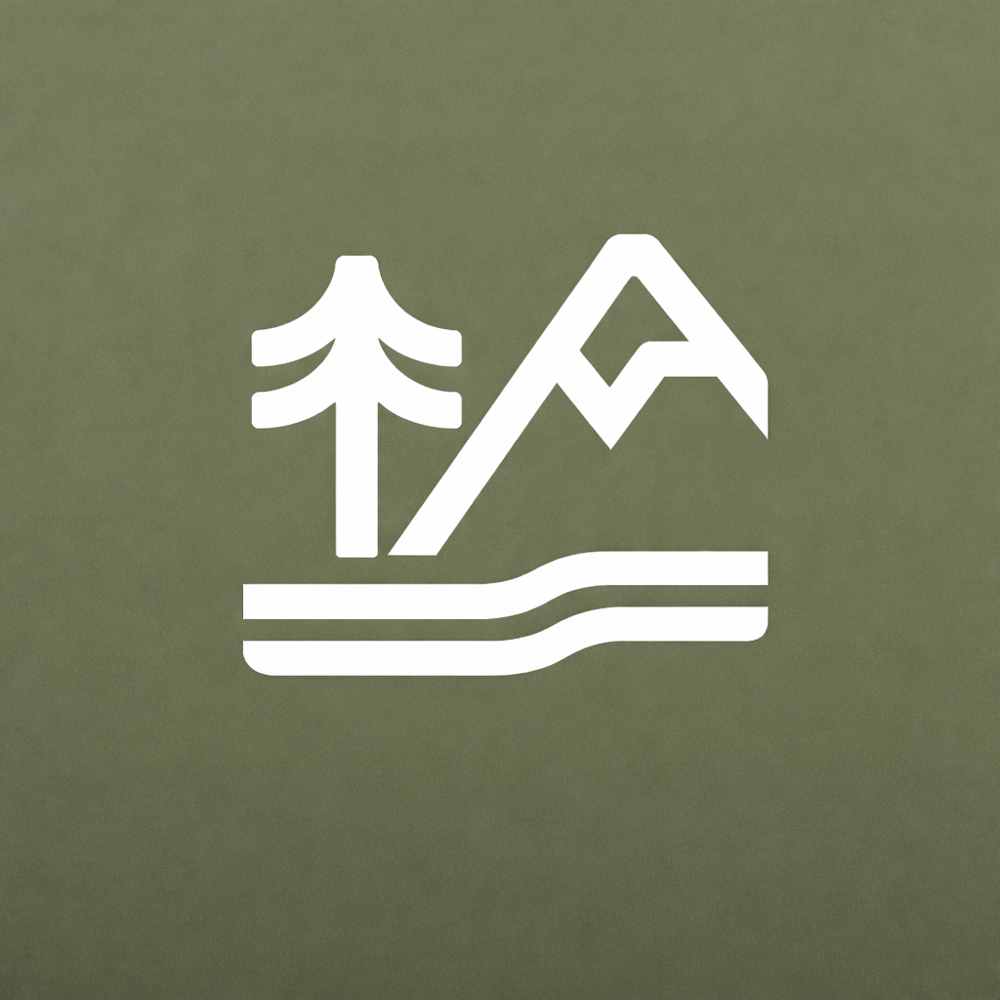
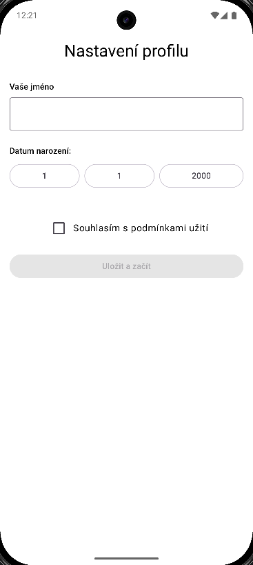
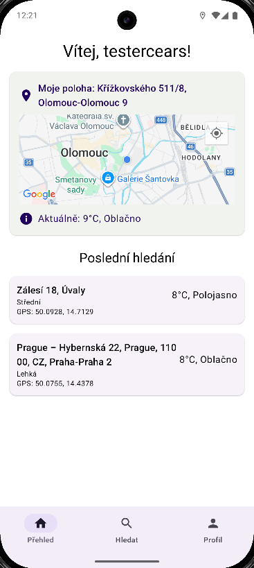
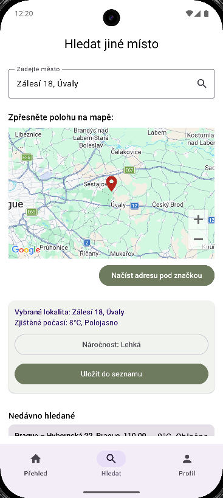
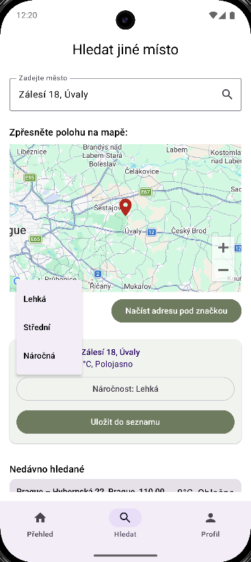
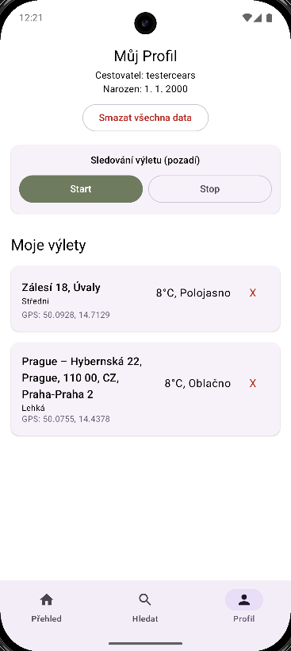
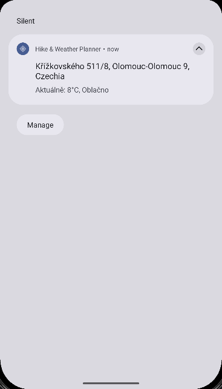
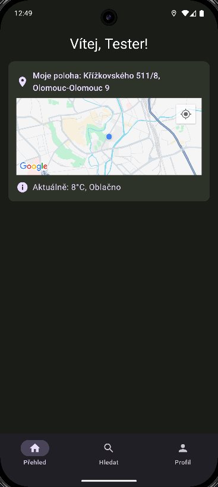
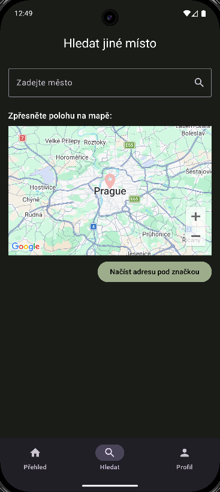
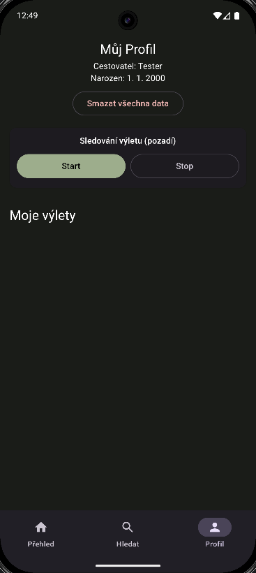

# Hike & Weather Planner



Android aplikace pro plánování výletů do přírody. Uživatel vyhledá místo, upřesní ho
na mapě, zjistí aktuální počasí a uloží si ho do seznamu plánovaných výletů. Během výletu
může zapnout sledování na pozadí, které v notifikaci průběžně ukazuje aktuální polohu
a počasí.

Moje první Android aplikace, vytvořená v rámci předmětu TMAA na Přírodovědecké fakultě
Univerzity Palackého v Olomouci (letní semestr 2026).

> **EN:** An Android app for planning outdoor trips – search for a place, refine it on
> a map, check the current weather and save it to a list of planned trips. A background
> tracking service shows the current location and weather in a notification.
> My first Android app, built for a university course (Kotlin, Jetpack Compose, Room,
> Retrofit, Google Maps).

## Funkce

- **úvodní nastavení profilu** – jméno, datum narození, souhlas s podmínkami
- **přehled (Dashboard)** – aktuální poloha z GPS a počasí v místě, seznam uložených výletů
- **vyhledávání míst** – podle názvu města, upřesnění polohy přetažením značky na mapě,
  načtení adresy pod značkou, aktuální počasí a volba náročnosti výletu
- **seznam výletů** – uložení do lokální databáze, mazání jednotlivých položek
- **sledování na pozadí** – služba na popředí (foreground service), která v notifikaci
  průběžně zobrazuje adresu a počasí v aktuální poloze
- **profil** – zobrazení údajů a smazání všech dat
- **světlý a tmavý režim** – vzhled se řídí nastavením systému

## Ukázky

| Nastavení profilu | Přehled | Vyhledávání |
|---|---|---|
|  |  |  |

| Volba náročnosti | Profil a výlety | Sledování na pozadí |
|---|---|---|
|  |  |  |

| Tmavý režim – přehled | Tmavý režim – vyhledávání | Tmavý režim – profil |
|---|---|---|
|  |  |  |

## Použité technologie

- **Kotlin**, **Jetpack Compose** (Material 3), Navigation Compose
- **Room** – lokální databáze profilu a výletů
- **Retrofit** + Gson – počasí z [OpenWeatherMap](https://openweathermap.org/api)
- **Google Maps Compose**, Play Services Location (GPS, geokódování)
- architektura ViewModel + Repository, rozdělení na `core` a `feature`
- minimální verze Androidu 12 (API 31)

## Sestavení

1. Otevřete projekt v Android Studiu.
2. Do souboru `local.properties` v kořeni projektu (není v repozitáři) doplňte API klíče:
   ```properties
   MAPS_API_KEY=váš_klíč_google_maps
   WEATHER_API_KEY=váš_klíč_openweathermap
   ```
   - Google Maps: [Google Cloud Console](https://console.cloud.google.com/) → Maps SDK for Android
   - OpenWeatherMap: [openweathermap.org](https://openweathermap.org/api) → bezplatný účet (Current Weather Data)
3. Spusťte aplikaci na zařízení nebo emulátoru s Androidem 12 a novějším.

## Historie verzí

| Verze | Popis |
|---|---|
| **1.0.1** | Doplnění informací a screenshotů tmavého režimu do README (kód beze změny). |
| **1.0.0** | Verze odevzdaná v předmětu TMAA. Historie vývoje během semestru (0.3–0.7.2) je zachovaná v commitech. Tlačítko *Zálohovat na Cloud* v této verzi zatím nemá funkci. |

## Licence

Všechna práva vyhrazena – zdrojový kód je zveřejněn pouze k nahlédnutí.
Podrobnosti v souboru [LICENSE](LICENSE).
