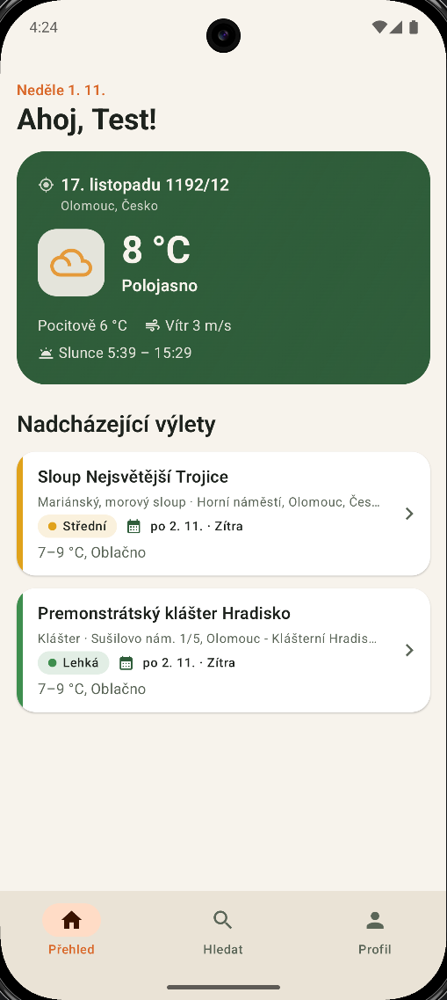
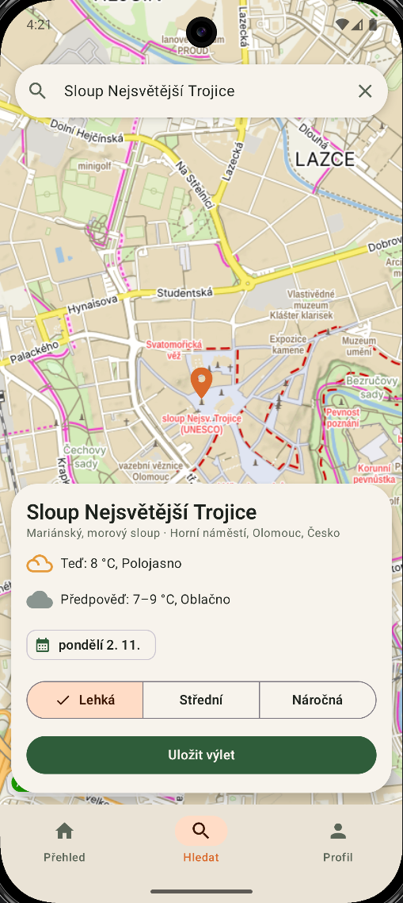
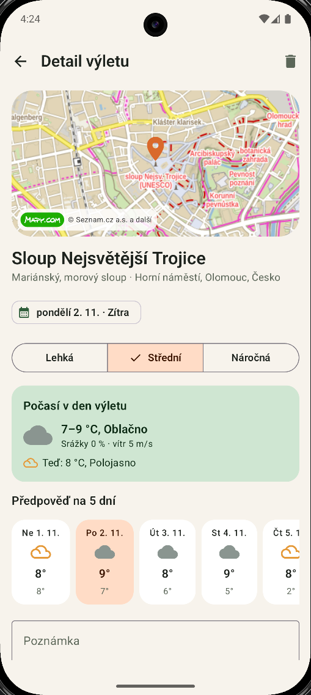
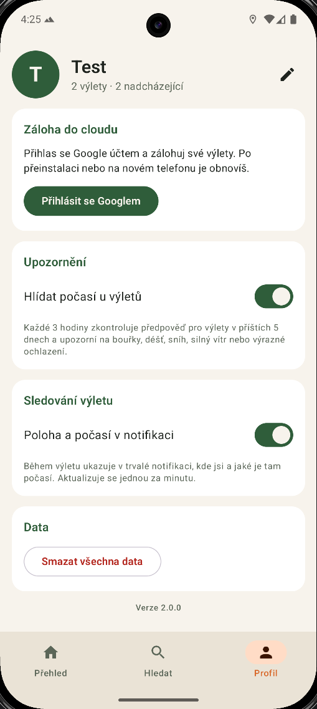
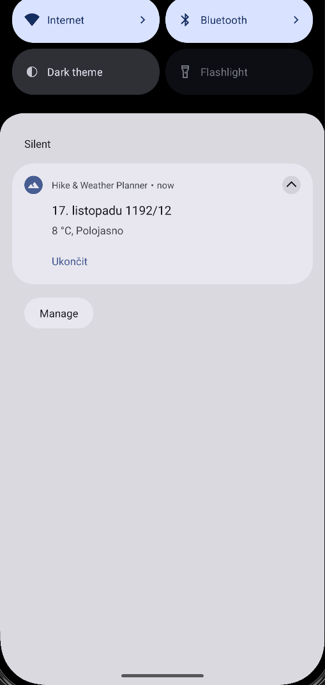
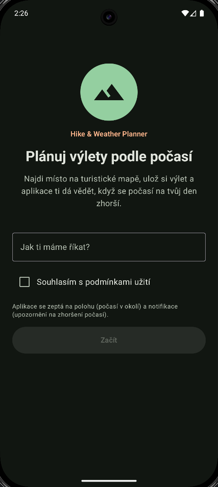
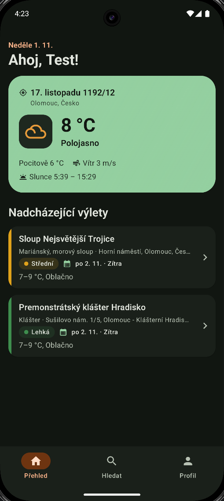
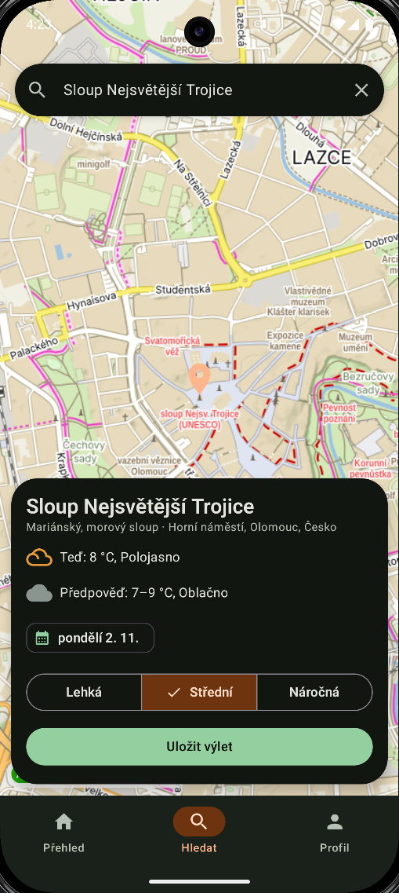
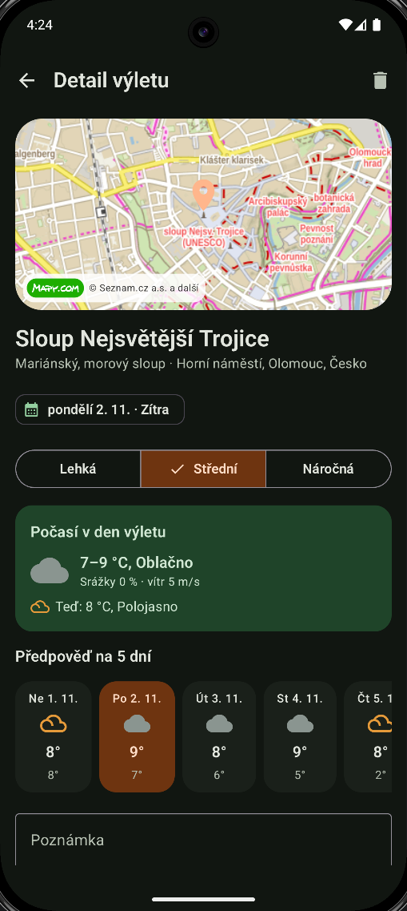

# Hike & Weather Planner


Android aplikace pro plánování výletů do přírody. Uživatel najde místo na turistické mapě
Mapy.com, vybere den výletu a uloží si ho. Aplikace pak hlídá předpověď počasí a pošle
upozornění, když se počasí na den výletu zhorší. Během výletu může v notifikaci průběžně
ukazovat aktuální polohu a počasí.

Moje první Android aplikace, původně vytvořená v rámci předmětu TMAA na Přírodovědecké
fakultě Univerzity Palackého v Olomouci (letní semestr 2026), ve verzi 2 přepracovaná.

> **EN:** An Android app for planning outdoor trips. Find a place on the Mapy.com hiking map,
> pick a date and save the trip – the app keeps checking the forecast and notifies you when
> the weather for your trip gets worse. Kotlin, Jetpack Compose, MVVM, Room, Retrofit,
> WorkManager, MapLibre, Firebase; unit tests and CI on GitHub Actions.

## Funkce

- **přehled** – počasí v místě, kde uživatel je (teplota, pocitová teplota, vítr, východ
  a západ slunce), výlety rozdělené na nadcházející, bez data a proběhlé
- **hledání míst** – turistická mapa Mapy.com přes celou obrazovku, našeptávání obcí,
  vrcholů, chat a dalších cílů, výběr místa posunem mapy
- **plánování výletu** – datum, náročnost, aktuální počasí a předpověď na zvolený den
- **detail výletu** – mapa, počasí v den výletu, předpověď na 5 dní, poznámka, otevření
  místa v aplikaci Mapy.com
- **hlídání počasí** – každé 3 hodiny kontrola předpovědi pro výlety v příštích 5 dnech
  (WorkManager), upozornění na bouřky, déšť, sníh, silný vítr nebo výrazné ochlazení;
  kliknutím na upozornění se otevře detail výletu
- **sledování výletu** – služba na popředí, která v notifikaci ukazuje aktuální místo
  a počasí
- **záloha do cloudu** – přihlášení Google účtem, ruční záloha a obnovení výletů (Firebase)
- světlý a tmavý režim podle nastavení systému

## Ukázky

| Přehled | Hledání | Detail výletu |
|---|---|---|
|  |  |  |

| Profil | Sledování výletu | Úvodní nastavení |
|---|---|---|
|  |  |  |

| Tmavý režim – přehled | Tmavý režim – hledání | Tmavý režim – detail |
|---|---|---|
|  |  |  |

## Použité technologie

- **Kotlin**, **Jetpack Compose** (Material 3), Navigation Compose
- architektura **MVVM** – ViewModel + StateFlow, repozitáře za rozhraními,
  jednoduchý kontejner závislostí (`AppContainer`)
- **Room** – lokální databáze výletů
- **Retrofit** + Gson – počasí a 5denní předpověď z [OpenWeatherMap](https://openweathermap.org/api),
  vyhledávání míst přes [REST API Mapy.com](https://developer.mapy.com/)
- **MapLibre** – zobrazení turistické mapy Mapy.com
- **WorkManager** – pravidelné hlídání předpovědi na pozadí
- **Firebase Authentication** (Credential Manager) a **Cloud Firestore** – záloha výletů
- Play Services Location – poloha telefonu
- **JUnit** a kotlinx-coroutines-test – unit testy vyhodnocení počasí, předpovědi,
  zálohy a ViewModelu vyhledávání
- **GitHub Actions** – sestavení a testy při každém pushi
- minimální verze Androidu 12 (API 31)

## Architektura

```
app/src/main/java/cz/polacek/hikeweather/
├── HikeWeatherApp.kt      aplikace a kontejner závislostí
├── MainActivity.kt
├── core/                  databáze, API rozhraní (OpenWeather, Mapy.com), nastavení
├── feature/
│   ├── weather/           modely počasí, souhrn předpovědi po dnech, vyhodnocení upozornění
│   ├── places/            vyhledávání míst a poloha
│   ├── trips/             výlety (Room)
│   ├── alerts/            notifikace a hlídání počasí (WorkManager)
│   ├── tracking/          sledování výletu (služba na popředí)
│   └── backup/            přihlášení a záloha do Firestore
└── ui/                    obrazovky (Compose) a jejich ViewModely, motiv, společné komponenty
```

## Sestavení

1. Otevřete projekt v Android Studiu.
2. Do `local.properties` v kořeni projektu (není v repozitáři) doplňte API klíče:
   ```properties
   WEATHER_API_KEY=klíč_openweathermap
   MAPY_API_KEY=klíč_mapy_com
   ```
   - OpenWeatherMap: [openweathermap.org](https://openweathermap.org/api) – bezplatný účet
     (Current Weather a 5 day / 3 hour Forecast)
   - Mapy.com: [developer.mapy.com](https://developer.mapy.com/) – bezplatný základní tarif
3. Pro zálohu do cloudu vytvořte projekt ve [Firebase](https://console.firebase.google.com/)
   s Android aplikací `cz.polacek.hikeweather` (včetně SHA-1 podpisového certifikátu),
   zapněte přihlášení přes Google a Cloud Firestore s pravidly:
   ```
   match /users/{userId}/{document=**} {
     allow read, write: if request.auth != null && request.auth.uid == userId;
   }
   ```
   a soubor `google-services.json` vložte do složky `app/` (není v repozitáři).
4. Spusťte aplikaci na zařízení nebo emulátoru s Androidem 12 a novějším.

## Historie verzí

| Verze | Popis |
|---|---|
| **2.0.0** | Přepracovaná aplikace: nový vzhled, turistická mapa a vyhledávání Mapy.com místo Google Maps, datum výletu a předpověď na 5 dní, hlídání počasí s upozorněním, detail výletu s poznámkou, záloha do Firebase, architektura MVVM, unit testy a GitHub Actions. Nový název balíčku `cz.polacek.hikeweather`. |
| **1.0.1** | Doplnění informací a screenshotů tmavého režimu do README (kód beze změny). |
| **1.0.0** | Verze odevzdaná v předmětu TMAA, dostupná pod tagem [`v1.0.0`](../../tree/v1.0.0). Historie vývoje během semestru (0.3–0.7.2) je zachovaná v commitech. |

<details>
<summary>Náhled verze 1.0.0</summary>

| Nastavení profilu | Přehled | Vyhledávání |
|---|---|---|
|  |  |  |

| Volba náročnosti | Profil a výlety | Sledování na pozadí |
|---|---|---|
|  |  |  |

</details>

## Licence

Všechna práva vyhrazena – zdrojový kód je zveřejněn pouze k nahlédnutí.
Podrobnosti v souboru [LICENSE](LICENSE). Mapové podklady a vyhledávání © Seznam.cz a.s.
a další ([Mapy.com](https://mapy.com/)), data o počasí [OpenWeather](https://openweathermap.org/).
